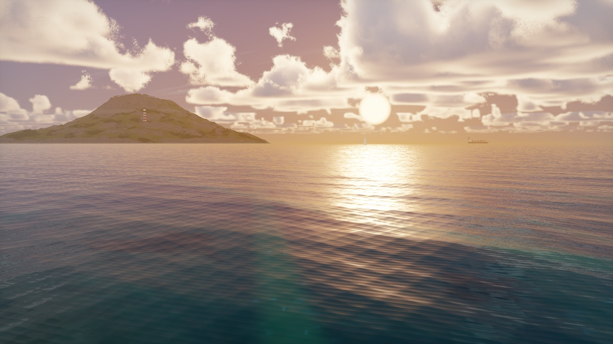
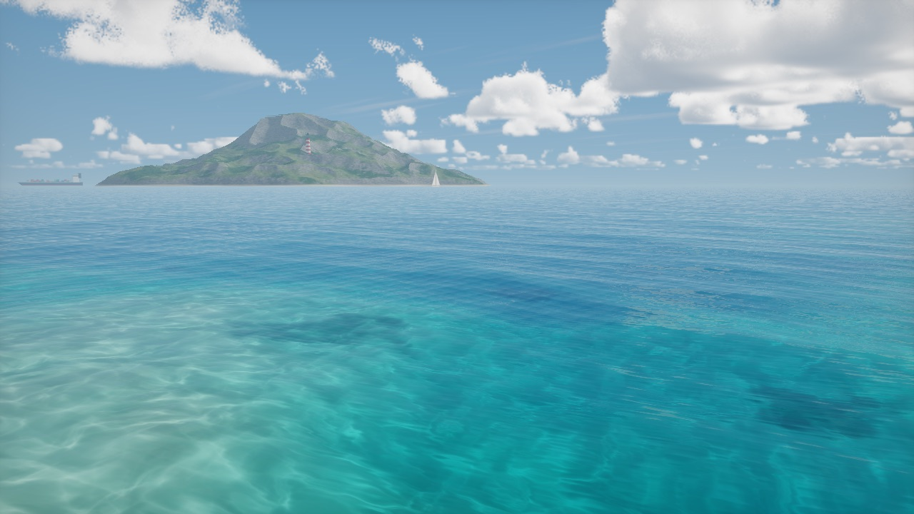
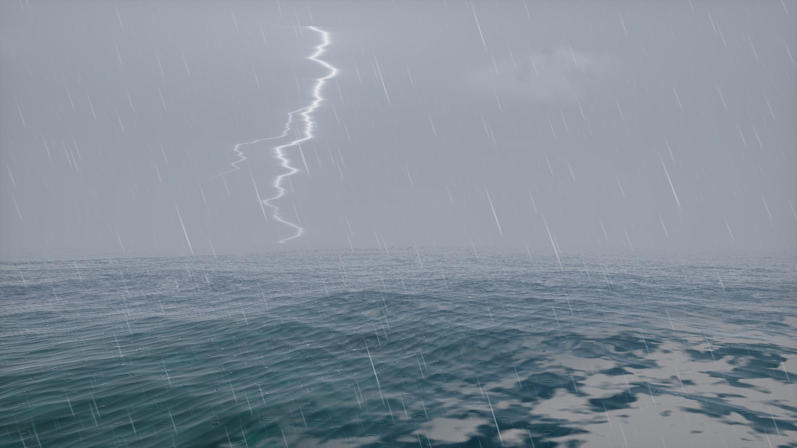
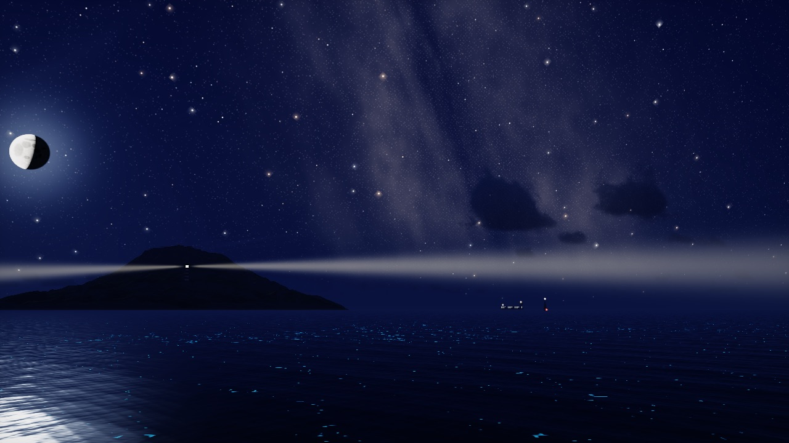
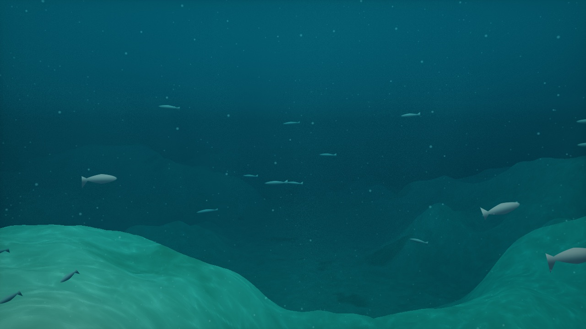
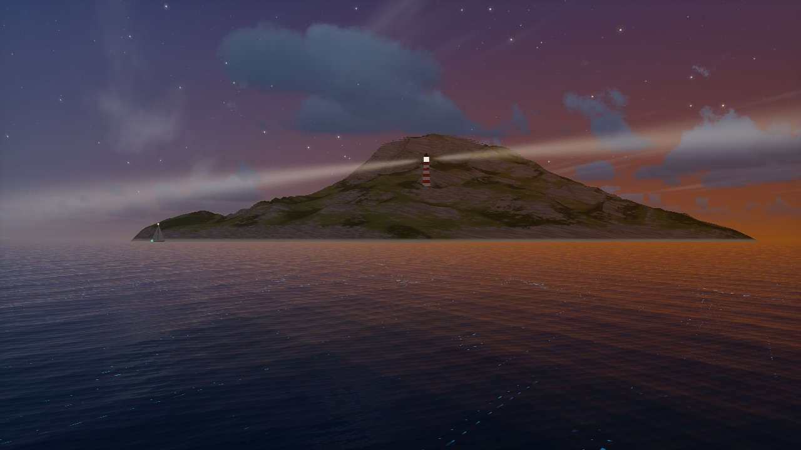

# Ocean View

A real-time ocean you can sail, fly over and dive into, right in the browser. Everything is in one HTML file, with no build step and no dependencies.

**[Live demo: viny4.github.io/ocean](https://viny4.github.io/ocean/)**



## Screenshots

| | |
|:---:|:---:|
|  |  |
| Sunny day | Storm with lightning |
|  |  |
| Night sky | Underwater |
|  | |
| Lighthouse at twilight | |

## Features

- **Water**: a wind-driven wave spectrum with choppiness, foam, reflections, clear shallows and adjustable depth and murkiness.
- **Sky**: volumetric clouds that drift with the wind, plus a full day cycle from dawn to night.
- **Weather**: 21 presets, including rain, drizzle, snow, sleet, hail, fog, haze, sandstorm, hurricane, waterspout, rainbow and aurora. **Live weather** mode drifts from one plausible weather to the next on its own.
- **Night sky**: stars and the Milky Way, moon phases, northern lights, shooting stars, planes with blinking lights, satellites, the ISS and Starlink trains, and glowing plankton in the water.
- **Real sky**: put the sun, moon and stars where they really are for your location and the current time.
- **Underwater**: dive below the surface to find caustics, a seafloor, schools of fish and god rays.
- **Lighthouse island**: a rocky island with cliffs, beaches and surf, and a lighthouse whose beams sweep the sea at night.
- **Life**: sailboats, a cargo ship and seagulls.
- **Sound**: procedural wind, waves, rain and thunder, all synthesized live with no audio files.
- **Photo mode**: save a full-resolution PNG of the current view, without the on-screen buttons.
- Your settings are remembered between visits.

## Controls

| Input | Action |
|---|---|
| `W` `A` `S` `D` / arrow keys | Move |
| Drag with the mouse (or touch) | Look around |
| `E` / `Space` | Go up |
| `Q` | Go down (press at the surface to dive) |
| Scroll wheel | Change height |
| `Shift` | Move faster |
| `H` | Open or close the settings panel |
| `M` | Sound on or off |
| `P` | Take a photo |

The buttons in the bottom-right corner do the same as `H`, `M` and `P`.

## Settings and presets

Press `H` (or the slider button) to open the settings panel.

- **Weather presets**: Sunny, Cloudy, Overcast, Drizzle, Rainy, Stormy, Foggy, Haze, Windy, Snowy, Sleet, Blizzard, Hail, Sandstorm, Hurricane, Waterspout, Rainbow, Aurora, Starry night, Meteors and Full moon. Presets roll in over a few seconds rather than switching instantly.
- **Live weather**: changes the weather by itself every minute or so.
- **Time of day**: Dawn, Morning, Noon, Golden hour, Twilight and Night.
- **Real sky now**: uses your time zone (or your location, if you allow it) to place the real sun and moon.
- **Sliders**, grouped into folding sections:
  - *Waves*: wind speed, wind direction, choppiness, foam
  - *Water*: murkiness, sea depth, glowing plankton
  - *Sky*: sun height, sun direction, clouds, cloud speed, air traffic
  - *Night sky*: moon phase, stars and Milky Way, satellites, shooting stars, northern lights
  - *Weather effects*: rain, snow, hail, fog, sand and dust, lightning, waterspout
  - *Life and sound*: boats and seagulls, sound volume
  - *Image*: exposure
- **Reset to default** puts everything back.

## Running locally

It's a single static file, so you can just open `index.html` in a browser.

If your browser is strict about local files, serve the folder instead:

```sh
python3 -m http.server
```

Then go to <http://localhost:8000>.

## Browser support

- Needs **WebGL 1**, which every current version of Chrome, Edge, Firefox and Safari supports.
- Everything is ray-marched in a fragment shader, so it works best on a desktop or laptop with a decent GPU. The render resolution adapts automatically to keep the frame rate smooth, so it still runs on phones and integrated graphics, just less sharply.
- Browsers only allow sound after you interact with the page, so sound starts on your first click or key press.
- Real sky asks for your location, but it still works from your time zone if you say no.

## License

[MIT](LICENSE)
